# Microsoft 365 Security Lab: MFA and Conditional Access for a small manufacturer

I set up a Microsoft 365 Business Premium trial tenant for a made-up small manufacturer, "LAB", and fixed six simulated security problems using MFA, Conditional Access, least-privilege roles and a leaver process. The fixes cover two Cyber Essentials controls: **user access control** and **secure configuration**.

> The starting problems (F1–F6) are a simulated scenario I designed, not a real company's findings.

## What I built

- **Tenant:** Microsoft 365 Business Premium trial (Entra ID, Exchange Online)
- **Users:** Rizwan Basha (admin), Alice Test, Bob Builder, Chris, Dona, Ed (leaver), and Storm Breaker (break-glass account)
- **Group:** All staff
- **Conditional Access policies:** CA01 (MFA for all users), CA02 (block legacy authentication), CA03 (MFA for admin roles). All exclude Storm Breaker. Each was created in Report-only mode, tested, then switched On.
- **Shared mailbox:** office@, used by Alice and Dona with their own accounts

## Before and after, mapped to Cyber Essentials

| # | Before (simulated finding) | Control | After (what I did) | Evidence |
| --- | --- | --- | --- | --- |
| F1 | No MFA on any account | User access control | MFA required for all users with CA01 and Microsoft's baseline policy. Tested by signing in as Bob. | [Policy list](screenshots/01-policy-list-all-on.png), [Bob's sign-in log](screenshots/03-bob-signin-log-conditional-access.png) |
| F2 | Everyone is a Global Admin | User access control | Only Storm Breaker (break-glass) is Global Admin. Alice has User Administrator only. CA03 requires MFA for admin roles. Alice's access to Conditional Access returned 401. | [Alice's 401 page](screenshots/10-alice-401-least-privilege.png) |
| F3 | Former employee's account still active | User access control | Ed's sessions revoked, sign-in blocked, licence removed. Ed is not in All staff and was removed from the Lab team. | [Ed blocked](screenshots/07-ed-blocked.png), [removed from team](screenshots/08-ed-removed-from-lab-team.png), [All staff](screenshots/12-all-staff-group.png) |
| F4 | Three people share one login (office@) | User access control | office@ is now a shared mailbox. Alice and Dona use their own accounts. | [Shared mailbox](screenshots/09-shared-mailbox.png) |
| F5 | Legacy sign-in methods allowed | Secure configuration | CA02 blocks legacy authentication. Tested in Report-only mode first. | [Policy list](screenshots/01-policy-list-all-on.png) |
| F6 | No written password, MFA or phishing guidance | Policy (supports all controls) | Wrote a password and MFA policy, a staff phishing guide and a leavers checklist. | [policies/](policies/) |

## Testing results

MFA was required for Bob, and no policy applied to Storm Breaker. All tests came from the Entra sign-in logs and the Conditional Access What If tool.

| Test | Result |
| --- | --- |
| Bob signs in from a browser | MFA required. Microsoft's "Require MFA for all users" succeeded and CA01 reported success in Report-only mode. CA02 and CA03 did not apply (browser sign-in, not an admin). |
| Admin (Rizwan Basha) signs in | CA01 and CA03 both reported success in Report-only mode. |
| What If: Bob | 2 policies apply: Microsoft's MFA for all users, and CA01. |
| What If: Storm Breaker | 0 policies apply, 7 do not apply, after the account was excluded from Microsoft's managed MFA policies too. |
| Alice (User Administrator) after MFA setup | Sees only Users and Billing → Licenses / License requests. No products, bills or payment methods. |
| Alice opens Entra Conditional Access | 401: "Insufficient privileges to complete the operation." |
| Ed (leaver) | Sign-in blocked, sessions revoked, licence removed. |
| office@ shared mailbox | Members are Alice and Dona, each on their own account. |

The sign-in log only recorded "MFA requirement satisfied by claim in the token". It did not name the MFA method used.

### Screenshots

**Policies in Report-only mode, before enforcing:** CA01–CA03 created and tested without affecting anyone.
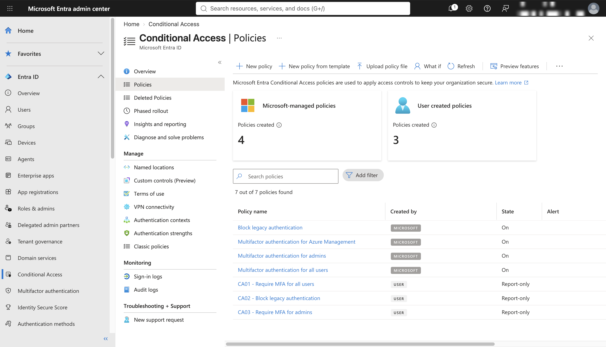

**Policies switched On:** the four Microsoft-managed policies plus CA01–CA03.
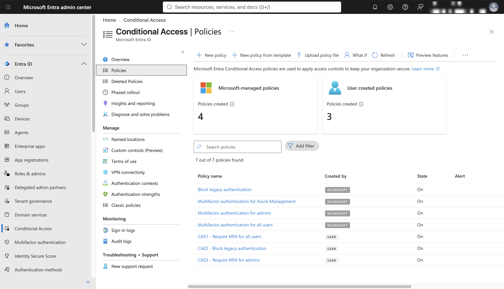

**Bob's MFA setup (Microsoft Authenticator added).**
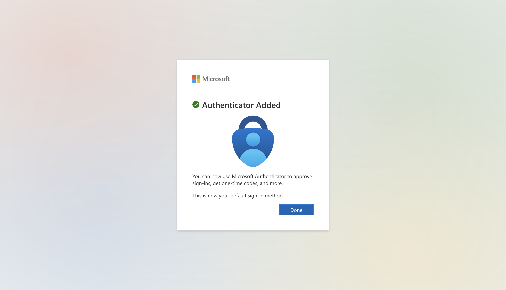

**Bob's sign-in log, Conditional access tab.** These four rows are the Microsoft-managed policies.
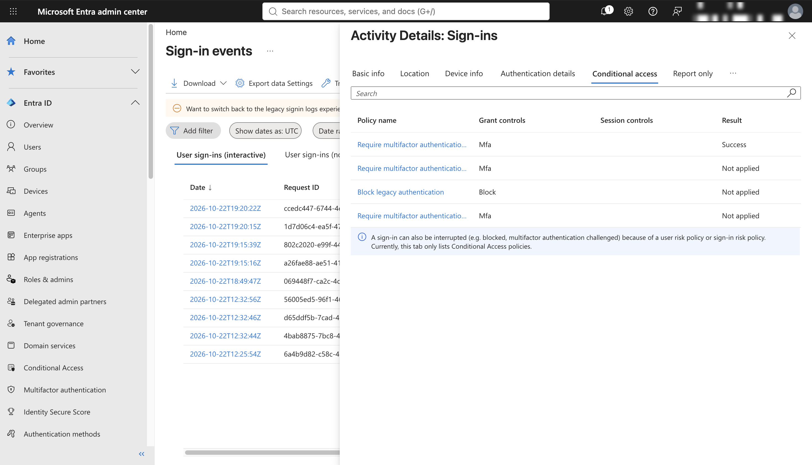

**What If for Bob, taken while CA01–CA03 were in Report-only mode.** Two policies apply, five do not.
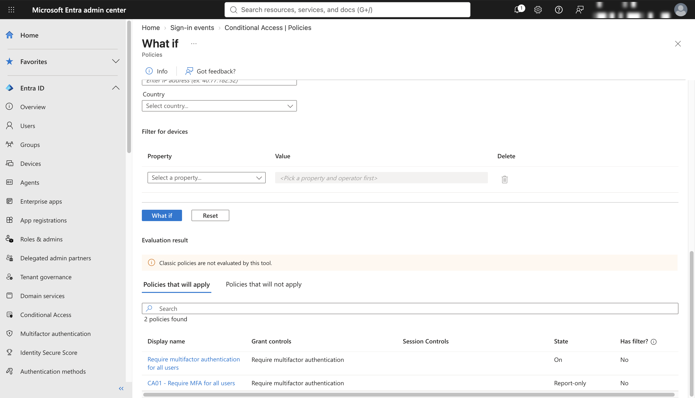
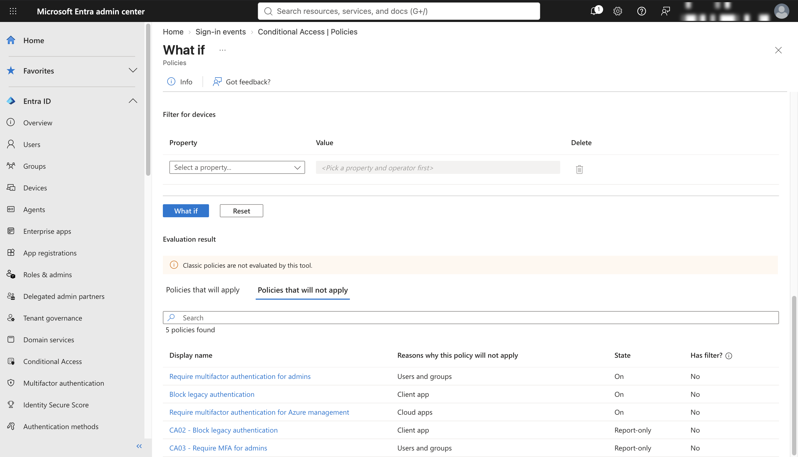

**What If for Storm Breaker, before excluding it from Microsoft's managed policies.** The managed admin and all-users policies still apply.
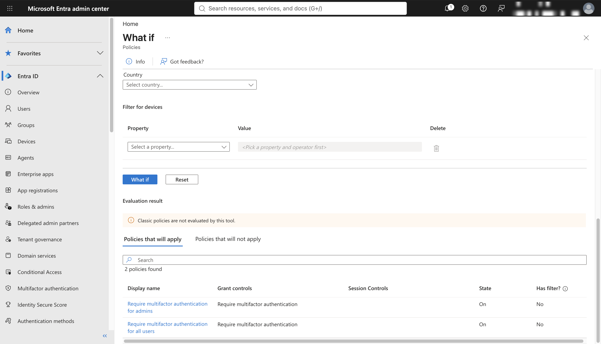
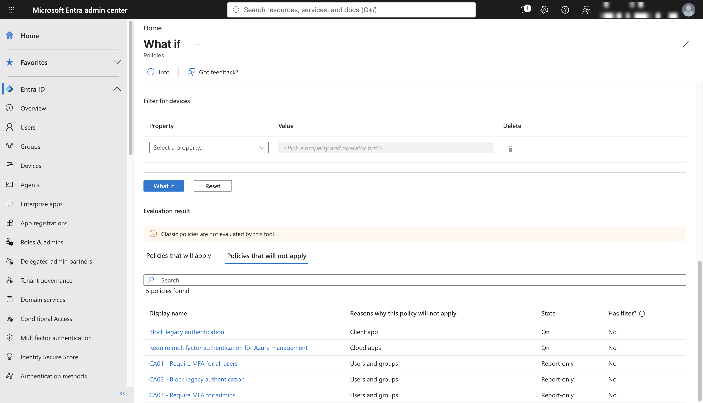

**What If for Storm Breaker, after.** 0 policies apply, 7 do not.
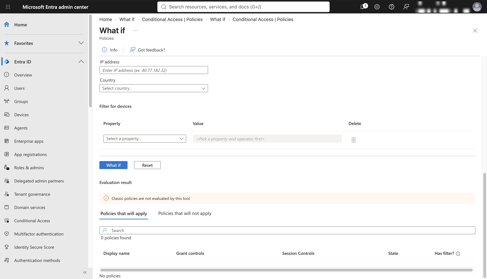
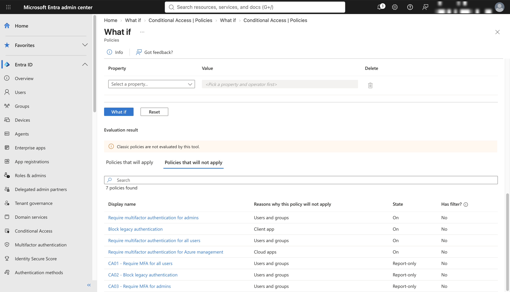

**CA01 details:** Report-only, applies to all users, 1 user excluded (Storm Breaker).
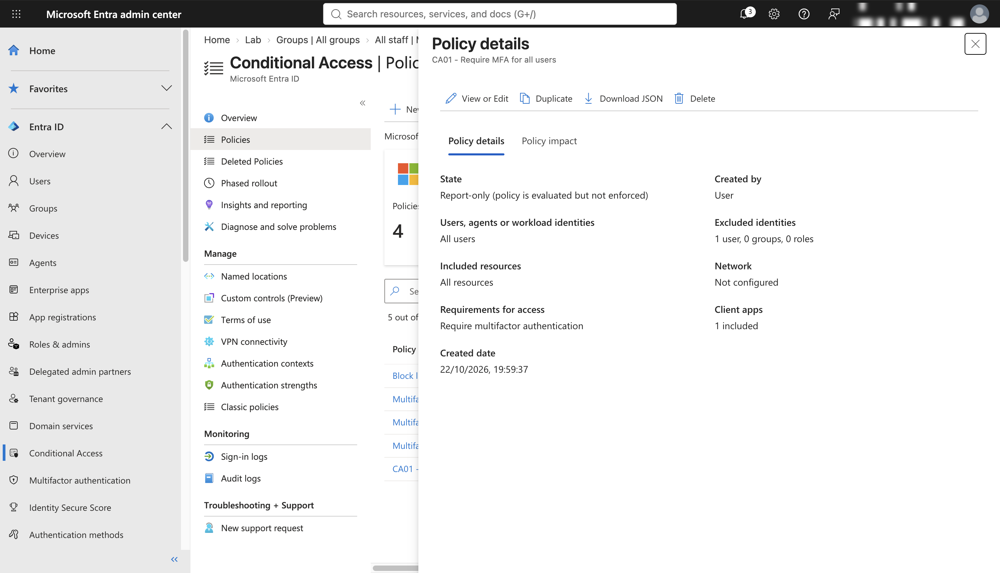

**Ed (leaver):** sign-in blocked, then removed from the Lab team. Ed is not in All staff.
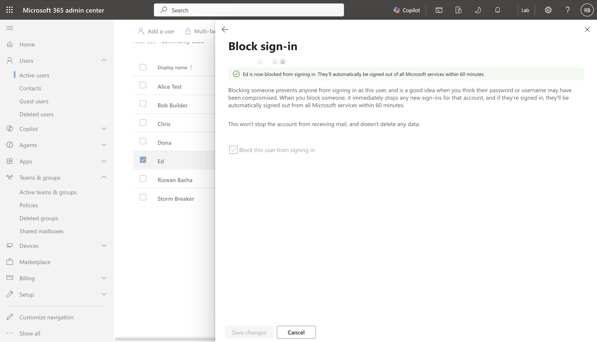
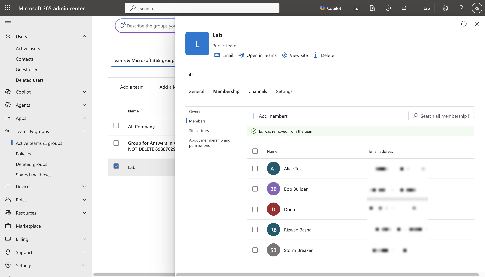
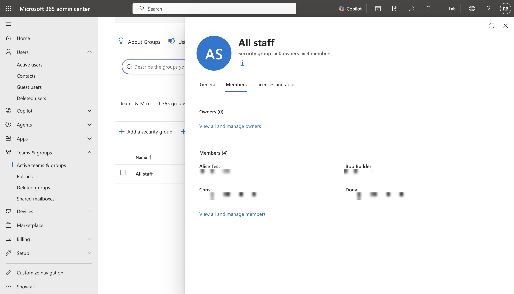

**office@ shared mailbox:** Alice and Dona are members.
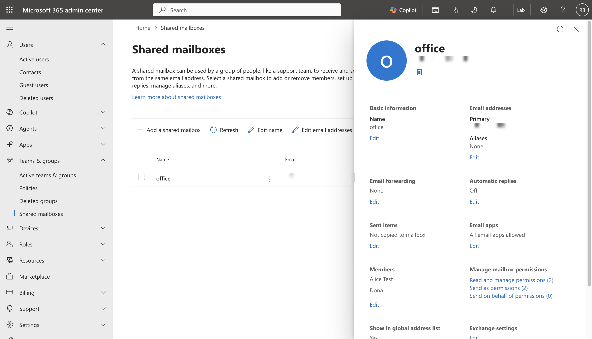

**Alice (User Administrator) cannot open Conditional Access:** 401, insufficient privileges.
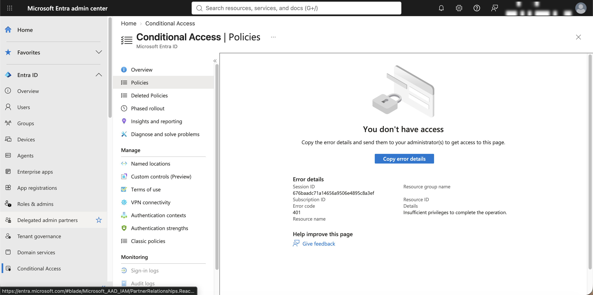

**Users in the tenant.**
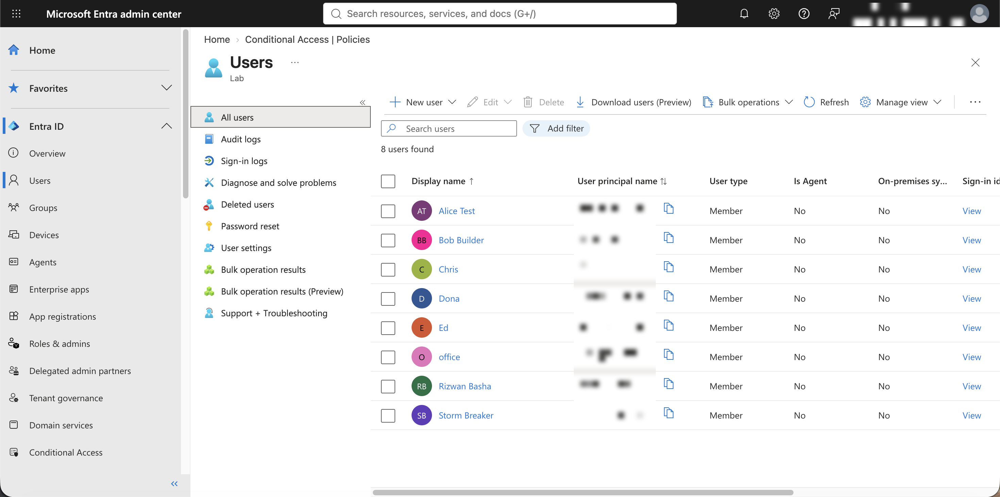

## What I learned

- **Microsoft already enforces some of this.** The tenant came with managed baseline policies (MFA for all users, MFA for admins, block legacy authentication) switched On. My CA01–CA03 overlap with them, so I treated mine as the documented, tested version of the same controls.
- **Exclusions must be made in every policy.** Storm Breaker had to be excluded from Microsoft's managed MFA policies as well as CA01–CA03. What If showed this: it only reached 0 applying policies after I did.
- **Report-only first.** Running each policy in Report-only mode and reading the sign-in log showed what it would do before it could lock anyone out.
- **Admin-portal MFA can't be excluded.** Microsoft makes MFA mandatory for admin portals. A real break-glass account therefore needs a passkey or security key, not just a long password.
- **Least privilege has a visible effect.** With User Administrator only, Alice could manage licences but got a 401 on Conditional Access.
- **Tooling quirks.** portal.office.com gave a connection-reset error until I used m365.cloud.microsoft and admin.cloud.microsoft and adjusted the browser's tracking protection.
- **Check the request, not the writing.** In my MSc group project on phishing awareness (22 participants), people and detection software couldn't reliably spot AI-written phishing. So the staff guide focuses on checking what is being asked, not on typos.

## What is not covered

- Firewalls, malware protection, security update management and backups.
- Storm Breaker has a password only. Next step: add a passkey or security key.
- Next step: consider an authentication strength setting to require phishing-resistant sign-in methods.

## Policies

- [Password and MFA policy](policies/password-and-mfa-policy.md)
- [Staff phishing guide](policies/staff-phishing-guide.md)
- [Leavers checklist](policies/leavers-checklist.md)
